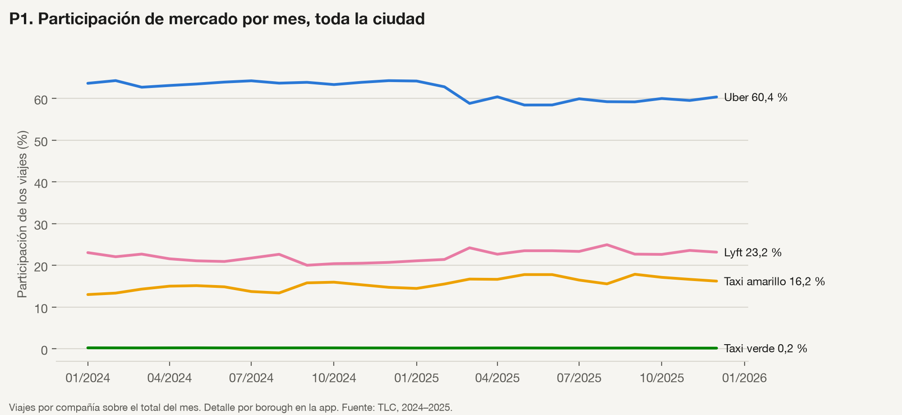
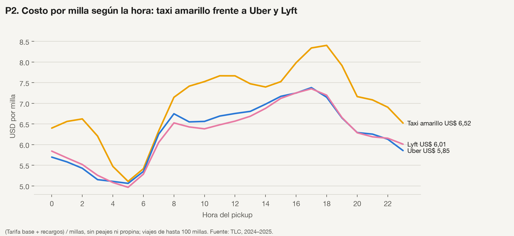
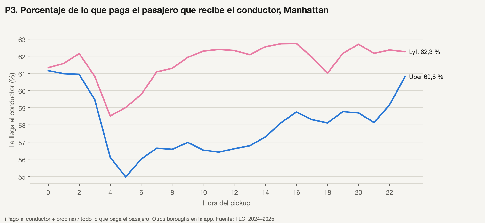
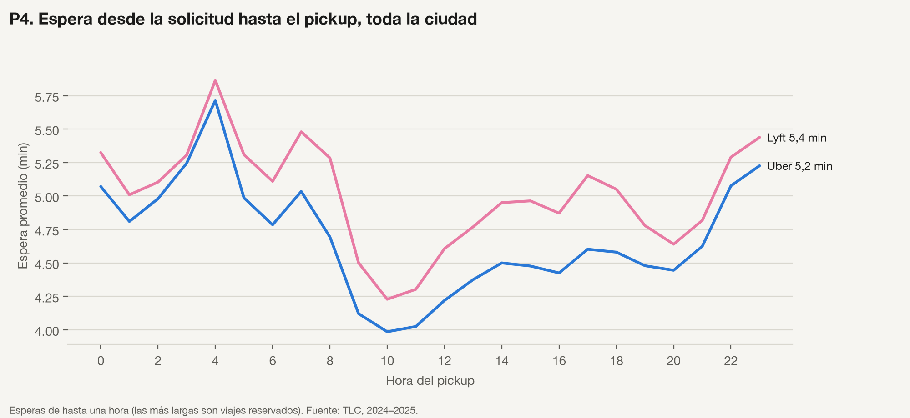
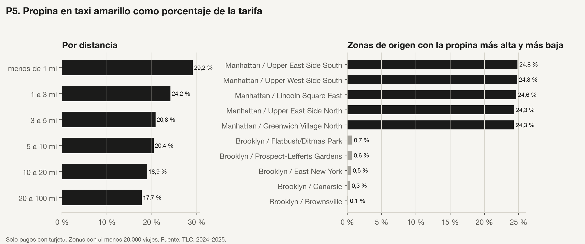
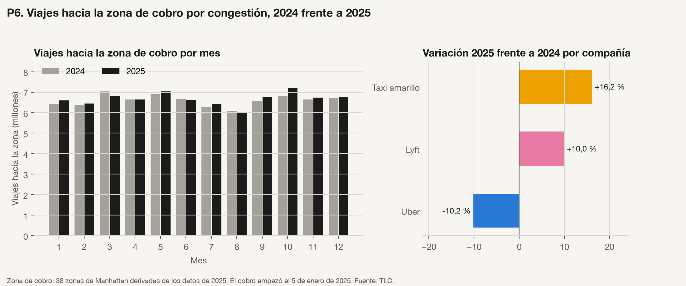

# Punto 8 — Visualización y aplicación

Un tablero en Streamlit con las seis preguntas y seis gráficas estáticas para el documento. Las dos cosas leen los resultados del [Punto 6](../punto6-analitica-sql/) a través de una API expuesta en API Gateway.

```
Navegador ──http:8501──> Streamlit (EC2 tlc-streamlit, t3.small)
                             │  GET /resultados/{pregunta}
                             ▼
                API Gateway (HTTP API tlc-resultados)
                             │
                             ▼
                Lambda tlc-resultados ──> s3://<bucket>/resultados/punto6/athena/pN/resultado.csv

graficas.py (portátil) ──GET /resultados/{pregunta}──> la misma API ──> graficas/p1..p6.png
```

## La API

| Ruta | Devuelve |
|---|---|
| `GET /resultados` | Las seis preguntas con su título y su ruta |
| `GET /resultados/{pregunta}` | `{"pregunta", "titulo", "columnas", "filas"}` de `p1` a `p6`; 404 con un mensaje si la pregunta no existe |

[`lambda_resultados.py`](lambda_resultados.py) lee el CSV que deja `athena.py`. Los cuatro motores dan los mismos números (`comparar.py`), así que da igual de cuál se lea. Las gráficas no consultan trusted en vivo: Athena cobra por dato escaneado y los resultados ya están calculados.

## Por qué Streamlit va adelante de API Gateway y no detrás

La rúbrica dice "Streamlit detrás de API Gateway". Lo probamos así y no funciona: Streamlit necesita un WebSocket (`/_stcore/stream`) entre el navegador y el servidor, y una HTTP API de API Gateway con integración `HTTP_PROXY` deja pasar el HTTP pero no ese WebSocket.

| | `GET /` | `GET /_stcore/health` | WebSocket `/_stcore/stream` |
|---|---|---|---|
| Directo a la EC2 | 200 | 200 `ok` | **101** (conecta) |
| Por API Gateway | 200 | 200 `ok` | **400** |

| Directo a la EC2 | Por API Gateway |
|---|---|
|  |  |

Por API Gateway la página llega, pero la app se queda en el esqueleto de carga porque nunca conecta el WebSocket. Por eso API Gateway expone los datos y Streamlit los consume. Se descartó un ALB delante de Streamlit: soporta WebSocket, pero no es API Gateway.

La prueba se repite con [`prueba_apigw_streamlit.py`](prueba_apigw_streamlit.py) (`crear`, `probar` tras ~2 min, `borrar`). Crea una EC2 y un security group con el 8501 abierto, así que siempre hay que terminar con `borrar`.

## El tablero

Una pestaña por pregunta. Cada una tiene la pregunta, de dos a cuatro cifras clave, la conclusión en una frase, la gráfica con tooltip, un selector de borough donde aplica y la tabla completa. Las agregaciones de [`app/analisis.py`](app/analisis.py) son exactas:

- **P1 y P6** suman conteos.
- **P2** recompone la tarifa total como costo por milla × millas, así que sigue siendo razón de sumas (convención "Métrica de P2").
- **P4** pondera los promedios por viajes.
- **P3** se muestra por borough, porque sin el total pagado de cada grupo no se puede agregar entre boroughs.

Color fijo por compañía: Uber azul, Lyft magenta, taxi amarillo y taxi verde. La paleta pasa el validador de daltonismo en modo claro. En modo oscuro el par verde/amarillo no pasa para protanopía, así que la app y las gráficas van en tema claro. Cada línea lleva el nombre de la compañía al final, así que la identidad no depende solo del color.

## Archivos

| Archivo | Qué hace |
|---|---|
| [`lambda_resultados.py`](lambda_resultados.py) | La Lambda de la API |
| [`desplegar.py`](desplegar.py) | Crea o actualiza la Lambda, la API, el security group y la EC2; publica la app y la prueba en la EC2 |
| [`app/app.py`](app/app.py) | El tablero de Streamlit |
| [`app/analisis.py`](app/analisis.py) | Prepara los datos de cada pregunta; lo usan la app y `graficas.py` |
| [`app/test_app.py`](app/test_app.py) | Corre la app sin navegador (AppTest), recorre cada selector y falla si algo lanza una excepción |
| [`graficas.py`](graficas.py) | Las seis gráficas estáticas para el documento, en `graficas/` |
| [`prueba_apigw_streamlit.py`](prueba_apigw_streamlit.py) | La prueba de Streamlit detrás de API Gateway |

## Reproducir

Desde la raíz del repo, con el Punto 6 corrido (los CSV en `resultados/`):

```bash
python punto8-visualizacion-app/desplegar.py               # imprime la URL de la API y la de Streamlit
python punto8-visualizacion-app/desplegar.py --ip 1.2.3.4  # abre el 8501 a otra IP (la de la sala, por ejemplo)
python punto8-visualizacion-app/graficas.py                # PNG en punto8-visualizacion-app/graficas/
python punto8-visualizacion-app/desplegar.py --apagar      # al terminar: detiene la EC2
python punto8-visualizacion-app/desplegar.py --borrar      # borra la EC2, el security group, la API y la Lambda
```

`desplegar.py` es idempotente: la segunda vez actualiza el código de la Lambda y de la app (por SSM) y vuelve a correr `test_app.py` en la EC2. El puerto 8501 queda abierto solo a la IP pública de quien lo corre; en la sustentación hay que volver a correrlo desde la red de la sala, o pasarle esa IP con `--ip`. La API es pública: solo sirve resultados agregados.

## Gráficas

| | |
|---|---|
|  |  |
|  |  |
|  |  |

## Evidencias

Pendientes (Jean): el tablero con dos o tres pestañas, la consola de API Gateway con la API `tlc-resultados` y sus dos rutas, y una respuesta de `GET /resultados/p6` en el navegador.
