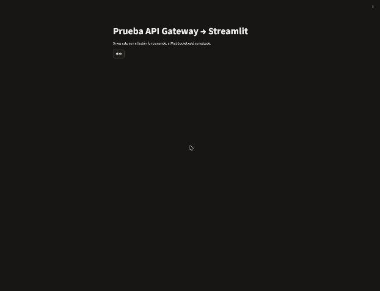

# Punto 8 — Visualización y aplicación

**Pendiente.** Gráficas de los resultados y una app en Streamlit expuesta por API Gateway. La propuesta de diseño está en `docs/design/puntos6-8-analitica/working/propuesta-punto8.md`.

## Prueba: ¿API Gateway puede hacer de proxy a Streamlit? (2026-11-17)

No. Streamlit necesita un WebSocket (`/_stcore/stream`) entre el navegador y el servidor, y una HTTP API de API Gateway con integración `HTTP_PROXY` deja pasar el HTTP pero no el handshake de WebSocket:

| | `GET /` | `GET /_stcore/health` | WebSocket `/_stcore/stream` |
|---|---|---|---|
| Directo a la EC2 | 200 | 200 `ok` | **101** (conecta) |
| Por API Gateway | 200 | 200 `ok` | **400** |

| Directo a la EC2 | Por API Gateway |
|---|---|
|  |  |

Por API Gateway la página llega, pero la app se queda en el esqueleto de carga porque nunca conecta el WebSocket.

Para reproducirla, desde la raíz del repo y con las credenciales del lab (crea una EC2 t3.small, un security group con el 8501 abierto y una HTTP API; `borrar` los quita):

```bash
python punto8-visualizacion-app/prueba_apigw_streamlit.py crear
python punto8-visualizacion-app/prueba_apigw_streamlit.py probar   # tras ~2 min, cuando Streamlit esté instalado
python punto8-visualizacion-app/prueba_apigw_streamlit.py borrar
```
